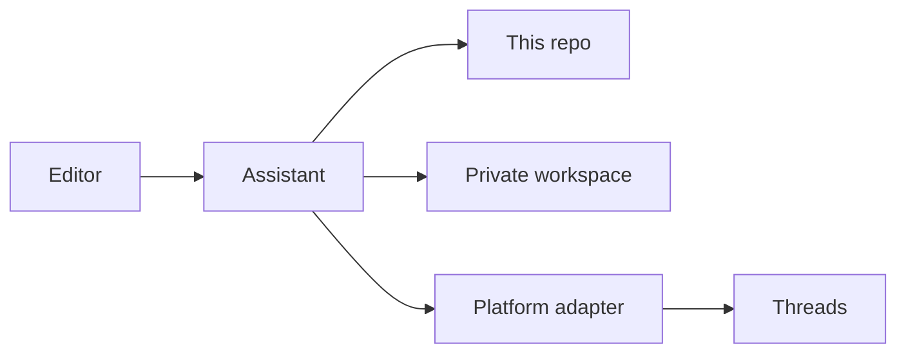

# Architecture

omni-sns-bot is a set of instructions and files. The editor's assistant is the runtime. There is no server to deploy.

## Pieces

| Piece | Role |
| --- | --- |
| `core/` | Platform-neutral editorial work: profile, voice, calendar, approval, FAQ. |
| `platforms/<id>/` | How that editorial work becomes a real action on one network. |
| `templates/` | Blank files copied into the workspace. |
| `examples/` | One fictional workspace committed so the bot can see a finished shape. |
| Private workspace | The only place a real account exists. Outside git. |
| `scripts/threads/` | Optional. A bot that can run Python and HTTP can use these instead of assembling curl by hand. A bot that cannot run them follows `platforms/threads/api.md` with whatever HTTP tool it has. |

## What is stable

The workspace files are the contract between sessions:

- `profile.yaml` — who the account is
- `style-guide.yaml` — how it sounds
- `approval-policy.yaml` — what may go out without a fresh yes
- `faq.yaml` — facts the bot is allowed to state
- `calendar.yaml` — every post and its state
- `logs/activity.jsonl` — what the bot already did

Core modules read and write those files. They do not hardcode Threads endpoints. When a calendar item has `platform: threads`, the bot opens `platforms/threads/` and follows that adapter.

## Adapter status

Each adapter has `capabilities.yaml` with `status`:

| Status | What the bot does |
| --- | --- |
| `implemented` | Follow that folder's publish and reply docs. |
| `not_implemented` | Record the editor's intent in the profile. Do not post. Tell them the adapter is a stub. |

v0.1 implements `platforms/threads` only.

## Modes

`profile.login.method` is one of:

| Method | Publisher |
| --- | --- |
| `api` | Official HTTP API described by the adapter. |
| `browser` | Editor-present browser steps, only after opt-in. |
| `draft_only` | No network publish. The bot still maintains the calendar and hands the editor finished text. |

Mode selection is in [`capabilities.md`](capabilities.md). Approval and safety wrap every mode, including `draft_only` (the bot still does not hand over a draft that fails the self-check).

## Adding a platform

Copy `platforms/_template/` and follow [`adding-a-platform.md`](adding-a-platform.md). Core stays unchanged unless the new platform needs a calendar field that Threads does not have. If you add a field, make it optional so existing workspaces still load.
